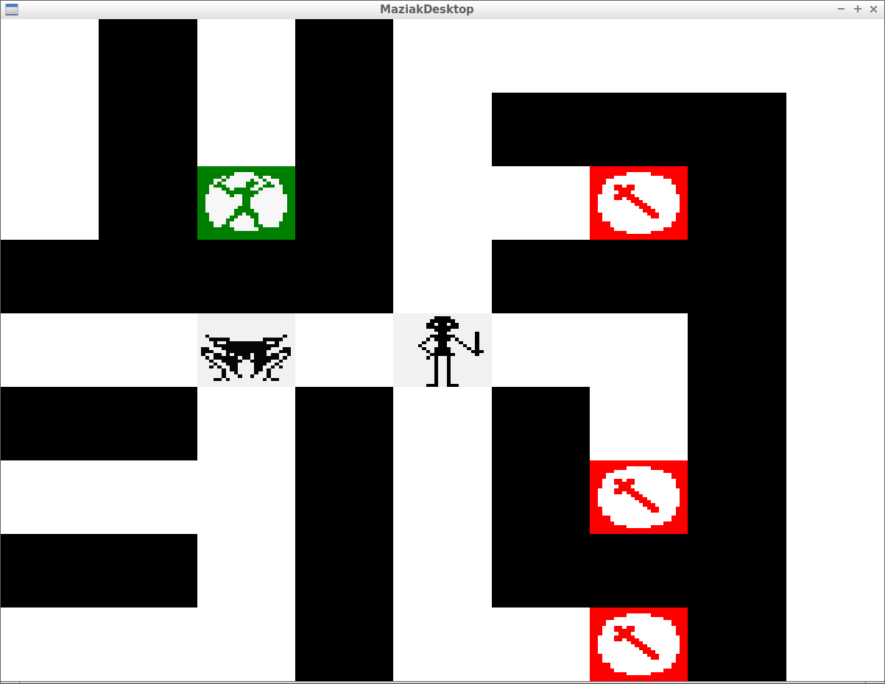
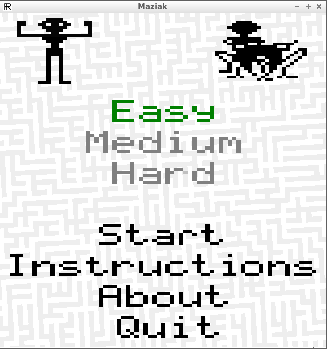

# Maziak

Maziak is a C++ maze game that is a port of the MSX game Maziak/Maziacs/Mazoggs
and one of
[Richèl Bilderbeek's games](https://richelbilderbeek.github.io/games).

 * [Video of Maziak at 2017-04-02 (zipped)](pics/20170402.zip)
 
